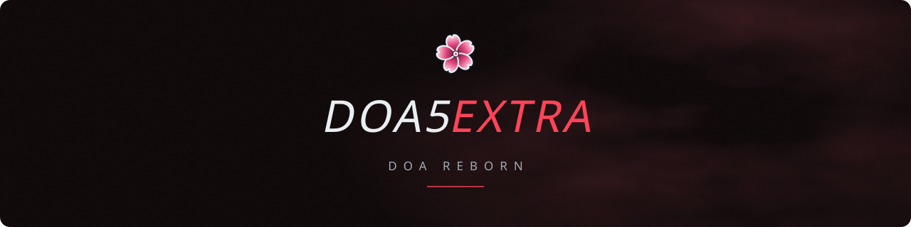

  

Extra modules for <b>Dead or Alive 5 Last Round</b>. Needs DOA5Tools (or an ASI Loader).

  
  
  
  

## Install

Use [DOA5Installer](https://github.com/DOAReborn/DOA5Installer/releases/latest) (manual install: extract the zip into the `scripts` folder next to `game.exe`).

Turn modules on or off in the **EXTRA OPTIONS** menu (main menu) or in `DOA5Extra.ini`.

## Modules

- **Style**: custom titles, new life bar colors.
- **Punish Training**: punishment challenges in Training (press L3).
- **Hitbox**: attack and body hitboxes in Training (press F6).
- **Critical Burst**: Updated Critical Burst fragments.
- **Bust physics**: breast press on contact.
- **Updated skin**: subsurface scattering and sweat.

## Build

32-bit, with [LLVM-MinGW](https://github.com/mstorsjo/llvm-mingw). From `src/`: `build.cmd` (C files with `gcc -c`, C++ files with `g++ -std=c++17 -c`, all with `-DDOA5EXTRA`, then one `g++ -shared -static -s` link with `-ld3d9 -lgdi32 -lwinmm -ladvapi32 -luser32`).
